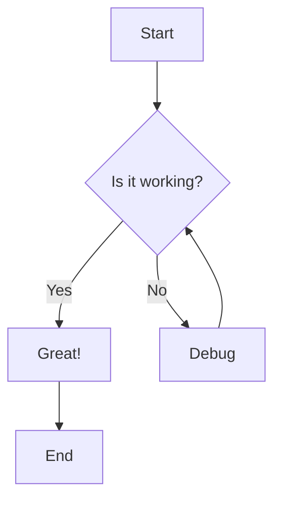
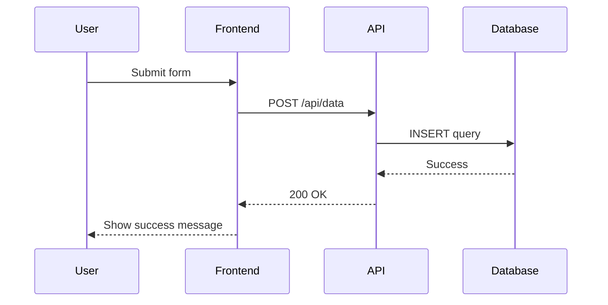
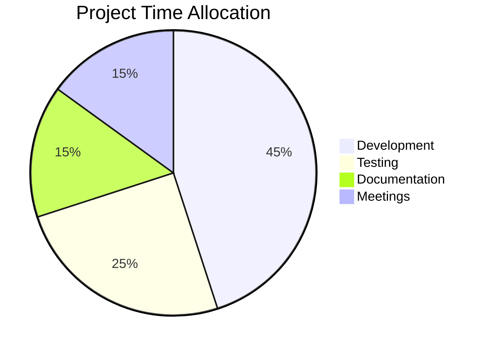

# Svelte Streamdown


A **Svelte port** of [Streamdown](https://streamdown.ai/) by Vercel - an all in one markdown renderer, designed specifically for AI-powered streaming applications.

## 📦 Installation

```bash
npm install svelte-streamdown
# or
pnpm add svelte-streamdown
# or
yarn add svelte-streamdown
```

## 🚀 Overview

Perfect for AI-powered applications that need to stream and render markdown content safely and beautifully, with support for incomplete markdown blocks, security hardening, and rich features like code highlighting, math expressions, and interactive diagrams.

## ✨ Main Features

### 🔄 Streaming-Optimized

- **Incomplete Markdown Parsing**: Handles unterminated blocks gracefully
- **Progressive Rendering**: Perfect for streaming AI responses
- **Real-time Updates**: Optimized for dynamic content
- **Smooth Animations**: Animate tokens and blocks as they are streamed.
- **An [`incomplete` signal](#the-incomplete-signal)** on the block still being streamed, so
  expensive renderers can wait and loading states need no JavaScript
- **Capped, self-scrolling blocks**: `codeBlockMaxHeight` / `tableMaxHeight` keep a long snippet or
  table pinned to its newest line while it streams

### 🔒 Security Hardening

- **Image Origin Control**: Whitelist allowed image sources
- **Link Safety**: Control link destinations

### 🎯 Fully Customizable Components & Theming

- **Every component customizable** with Svelte snippets
- **Granular theming system** - customize every part of every component
- Override default styling and behavior for any markdown element
- Full control over rendering with type-safe props
- Seamless integration with your design system

### 🎨 Built-in Typography Styles

Beautiful, responsive typography with **built-in Tailwind CSS classes** for headings, lists, code blocks, and more. Comes with a complete default theme that works out of the box.

### 📝 Extensive Markdown Features

Full support for

- Basic text marks: **bold**, _italic_, `code`, ~~Strikethrough~~
- ~Subscript~ and ^Superscript^
- [Links](https://svelte-streamdown.beynar.workers.dev/)
- Headings (H1–H6)
- Blockquotes
- Github alert
- Ordered & unordered lists (including roman, alpha, nested)
- Task lists ([ ] and [x])
- Code blocks
- Mermaid diagrams
- Math $expressions$, in `$…$` / `$$…$$` or the LaTeX `\(…\)` / `\[…\]` delimiters
- Escaping currency symbols ($140)
- Complex tables
- Footnotes [^1]
- Inline citations [ref] [ref2]
- MDX components (embed custom Svelte components)

[^1]:
    Reference render in a popover by default.
    with _rich_ **content** support
    and multiline

> [!NOTE]
> 🧠 **AI Prompting Tip:** For best results, use our [comprehensive prompt](/prompting) covering all supported markdown features.

### 🏷️ Raw HTML

`renderHtml` decides what happens to HTML in the markdown: off (the default) shows the source as
literal text, `true` renders it, and a function lets you sanitize it yourself and return the string.

Pretty-printed HTML has one markdown trap: four leading spaces after a blank line is an indented
code block, tag or not, so a nested `<div>` shows up in a code box instead of rendering.
`normalizeHtmlIndentation` dedents tag lines before parsing and leaves `<pre>` and `<code>` bodies
byte-for-byte:

```svelte
<Streamdown {content} renderHtml normalizeHtmlIndentation />
```

The trap only bites where blocks are not trimmed: `static`, `parseIncompleteMarkdown={false}`,
or calling the exported function on raw text. The default streaming path trims each block, which
strips the leading four spaces, so it never sees the code box in the first place.

It is off by default because dedenting is lossy, and it is exported as a plain function
(`import { normalizeHtmlIndentation } from 'svelte-streamdown'`) if you would rather pre-process
the string yourself.

### 💻 Interactive Code Blocks

- Syntax highlighting powered by [@tanstack/highlight](https://github.com/TanStack/highlight) (synchronous, SSR-friendly, ~31KB min / ~11KB gzip for every language)
- Copy-to-clipboard functionality
- Download the snippet with the extension of its language
- Support any `@tanstack/highlight` theme, or your own
- Optional line numbers (`lineNumbers`, off by default)

#### Line numbers

`lineNumbers` numbers every code block. It is a CSS counter on the line that is already
rendered — no extra element per line, and the numbers are pseudo-content, so copy,
download and text selection only ever give you the code.

```svelte
<Streamdown {content} lineNumbers />
```

Three words in the fence's info string, after the language, override the prop for
that block: `lineNumbers` numbers it even when the prop is off, `noLineNumbers` leaves
it unnumbered even when the prop is on, and `startLine=N` starts the count at N instead
of 1 (anything non-numeric is ignored).

````markdown
```ts startLine=10
const a = 1;
```

```ts noLineNumbers
const b = 2;
```
````

The gutter's width and colour are theme data (`theme.code.lineNumber`), so they follow
your theme like every other class.

### 🔢 Mathematical Expressions

LaTeX math support through KaTeX. Both delimiter styles are supported — dollars and the LaTeX delimiters LLMs usually emit:

- Inline math: `$E = mc^2$` or `\(E = mc^2\)` renders inline as $E = mc^2$
- Block (display) math: `$$ … $$` or `\[ … \]`

> `\(` and `\[` are always read as math delimiters — in static rendering as well as while streaming. Prose that uses them as literal-bracket escapes renders as math: `\[optional\]` is a display-math token, and an unterminated `Use \[ to open a bracket` is auto-closed into one by the completer (`parseIncompleteMarkdown={false}` stops that half). Escape the backslash — `\\[` — to keep the sequence literal. See the [4.1.0 behaviour changes](CHANGELOG.md#410).

$$
f(x) = \frac{1}{\sigma\sqrt{2\pi}} e^{-\frac{1}{2}\left(\frac{x-\mu}{\sigma}\right)^2}
$$

KaTeX is an **opt-in** heavy component, so you must import the `Math` component and pass it via the `components` prop. Without it, math is rendered as raw text:

```svelte
<script>
	import { Streamdown } from 'svelte-streamdown';
	import Math from 'svelte-streamdown/math'; // KaTeX math rendering
</script>

<Streamdown {content} components={{ math: Math }} />
```

Pass KaTeX options through the [`katexConfig`](#-props-api) prop (e.g. to set `throwOnError` or macros). See [Bundle Optimization](#-bundle-optimization) for details on enabling heavy components.

### 🧜‍♀️ Mermaid Diagrams

- Render Mermaid diagrams from code blocks, drawn by [pele](https://pele.run) — Mermaid syntax, no mermaid.js
- **Live rendering while streaming**: each finished line appears as it arrives
- Layout adapts to the column width (a wide flowchart turns vertical on a phone)
- Themed with CSS variables, so light/dark switches without a re-render
- Pan and Zoom
- Full screen mode
- Download as PNG, SVG or `.mmd` source

# **Example:**







### Complex table support

Tables copy and download as Markdown, HTML, CSV or TSV — see [Controls](#-controls) for the
separator and filename options, and for the exported table utilities.

#### Fullscreen

Wide tables get an expand toggle next to copy and download: it lifts the table out of the flow
(`position: fixed`, the whole viewport) so all of its columns are reachable, and the toolbar is
repositioned to the top right so copy and download stay usable. `Escape` or the same button — now a
close icon — collapses it and puts focus back on the toggle. While expanded the wrapper is a
`role="dialog"` container labelled with `translations.controls.table`, and it carries
`data-expanded="true"` plus the `theme.table.expanded` classes. It is deliberately not
`aria-modal`: the toolbar is a sibling of the wrapper, not a child, so marking the wrapper modal
would hide those buttons from assistive tech — that comes with a focus trap in a later release.
Turn it off with `controls={{ table: { fullscreen: false } }}`.

#### Colspan

| H1                        | H2  | H3  |
| ------------------------- | --- | --- |
| This cell spans 3 columns |     |     |

| Header 1                  | Header 2 | Header 3 |
| ------------------------- | -------- | -------- |
| This cell spans 2 columns |          | Normal   |
| Normal                    | Normal   | Normal   |

#### Rowspan

| Header 1        | Header 2 |
| --------------- | -------- |
| This cell spans | Cell A   |
| two rows ^      | Cell B   |

#### Footer

| Header 1        | Header 2 |
| --------------- | -------- |
| Cell B          | Cell A   |
| --------------- | -------- |
| Footer          |          |

#### Column alignment

| Left | Center | Right |
| :--- | :----: | ----: |
| A    |   B    |     C |

#### Multiple headers and very complex layout

| Product Category ||| Sales Data Q1-Q4 2024 ||||
| Product | Region || Q1 | Q2 | Q3 | Q4 |
| Name | Type | Area | Revenue | Revenue | Revenue | Revenue |
|-------------|---------|------------|---------|---------|---------|---------|
| Laptop Pro | Electronics | North America || $45,000 | $52,000 | $48,000 |
| Laptop Pro ^ | ^ | Europe | $32,000 | $38,000 | $41,000 | $44,000 |
| Laptop Pro ^ | ^ | Asia || $28,000 | $35,000 | $42,000 |
| Office Chair | Furniture | North America | $15,000 | $18,000 | $16,000 | $17,000 |
| Office Chair ^ | ^ | Europe | $12,000 | $14,000 | $15,000 | $16,000 |
| Wireless Mouse | Electronics | Global ||| $25,000 | $28,000 |
|-------------|---------|------------|---------|---------|---------|---------|
| **Total Revenue** ||| **$152,000** | **$185,000** | **$187,000** | **$205,000** |

### Complex list support

#### decimal

1. First item
2. Second item
3. Third item

#### lower-alpha

a. First item  
b. Second item  
c. Third item

#### upper-alpha

A. First item  
B. Second item  
C. Third item

#### lower-roman

i. First item  
ii. Second item  
iii. Third item

#### upper-roman

I. First item  
II. Second item  
III. Third item

#### Nested Lists

1. First level (numeric)
   a. Second level (lowercase alpha)
   i. Third level (lowercase roman) - Fourth level (bullet)
   I. Fifth level (uppercase roman)
   A. Sixth level (uppercase alpha)

2. Back to the first level

#### Task List

- [ ] Uncompleted task
- [x] Completed task
- [ ] Another uncompleted task
  - [ ] Nested uncompleted subtask
  - [x] Nested completed subtask

### Alert Support

> [!IMPORTANT]
> Native support for Github style Alert

### Description List

    :   Topic 1   :  Description 1
    : **Topic 2** : *Description 2*
    :   Topic 3   :  Description 3
    :   Topic 3   :  Description 3

### Citation Support

Streamdown supports inline citations that allow you to reference external sources and display them in interactive popovers. Citations work out-of-the-box with a simple object structure and support nested references like this `[cloudflare.website, vercel]` will render into [cloudflare.website, vercel]

To enable inline citations, pass a `sources` object as a prop to the `Streamdown` component.

#### Basic Usage

```svelte
<script>
	import { Streamdown } from 'svelte-streamdown';

	let content = `According to [smith2023], AI is advancing rapidly. See also [nested.subsection] for related work.`;

	let sources = {
		smith2023: {
			title: 'AI Research Paper',
			url: 'https://example.com/paper',
			content: 'Detailed content of the citation...'
		},
		nested: {
			subsection: {
				title: 'Nested Citation',
				url: 'https://example.com/nested'
			}
		}
	};
</script>

<Streamdown {content} {sources} />
```

#### Default Citation Structure

Citations work with objects containing these properties:

- `title (or name or author)`: Display title for the citation
- `url (or href, url, link or source)`: Link to the source
- `content (or text, summary or excerpt)`: Rich content to display in carousel mode

#### Display Modes

Streamdown offers two ways to display citations:

- **List View**: Shows all citations in a compact list format
- **Carousel View** (default): Step-through navigation for multiple citations with full content display

You can control the display mode using the `inlineCitationsMode` prop:

```svelte
<!-- List view -->
<Streamdown {content} {sources} inlineCitationsMode="list" />

<!-- Carousel view (default) -->
<Streamdown {content} {sources} inlineCitationsMode="carousel" />
```

#### Citation Popovers

Citations appear as clickable buttons that open popovers when clicked. The popover shows:

- Source title and URL (when available)
- Favicon from the source domain
- Rich content (in carousel mode)
- Navigation controls (in carousel mode for multiple citations)

#### Custom Citation Rendering

If your citation data structure doesn't match the default format, you can customize how citations are rendered using `inlineCitationPreview`, `inlineCitationContent` or `inlineCitationPopover` snippets:

```svelte
<Streamdown {content} {sources}>
	{#snippet inlineCitationPreview({ token })}
		<!-- Customize the clickable citation button -->
		{token.keys[0]}
	{/snippet}

	{#snippet inlineCitationContent({ source, key, token })}
		<!-- Customize content displayed in popover -->
		<div class="custom-content">
			<h4>{source.customTitle || key}</h4>
			<p>{source.customDescription}</p>
		</div>
	{/snippet}
</Streamdown>
```

These snippets allow you to:

- **`inlineCitationPreview`**: Customize the content of the clickable button that appears in the text
- **`inlineCitationContent`**: Customize how individual citation content is displayed within popovers
- **`inlineCitationPopover`**: Completely customize the list of citations

## 🔄 Differences from Original React Version

This Svelte port maintains feature parity with the original [Streamdown](https://streamdown.ai/) while adapting to Svelte's patterns:

| Aspect            | Original (React)         | Svelte Port                              |
| ----------------- | ------------------------ | ---------------------------------------- |
| **Framework**     | React                    | Svelte 5                                 |
| **Component API** | JSX Components           | Svelte Snippets                          |
| **Styling**       | Tailwind CSS             | Tailwind CSS (compatible)                |
| **Context**       | React Context            | Svelte Context                           |
| **Build System**  | Vite/React               | Vite/SvelteKit                           |
| **TypeScript**    | Full TS support          | Full TS support                          |
| **Engine**        | Remark / Rehype + marked | marked only                              |
| **Memoization**   | Memoized `Block` (LRU)   | Svelte reactivity (per-block `$derived`) |

### Tailwind CSS Setup

> [!NOTE]
> Streamdown comes with **built-in Tailwind CSS classes** for beautiful default styling. To ensure all styles are included in your build, add the following to your `app.css` or main CSS file:
> This setup is primarily necessary if you're using Tailwind CSS v4's new `@source` directive or if you have aggressive purging enabled in older versions. If you're using standard Tailwind CSS v3+ with default purging, Streamdown's styles should be automatically included when the component is imported and used in your application.
>
> This ensures that all Streamdown's default styling is included in your Tailwind build process.

```css
@import 'tailwindcss';
/* Add Streamdown styles to your Tailwind build */
@source "../node_modules/svelte-streamdown/**/*";
```

> [!IMPORTANT]
> The `@source` path is **relative to the stylesheet file** that contains the directive, so adjust the number of `../` segments to match where your stylesheet lives. The example above assumes `src/app.css`. If your global stylesheet lives one level deeper (e.g. `src/routes/+layout.css`, the default in newer SvelteKit projects), add one more `../` so the glob still resolves to your project's `node_modules`:

```css
@import 'tailwindcss';
/* Add Streamdown styles to your Tailwind build (stylesheet inside src/routes) */
@source "../../node_modules/svelte-streamdown/**/*";
```

## ⚡ Streaming Performance & Memoization

Like the original [Streamdown](https://streamdown.ai/), `svelte-streamdown` avoids re-parsing the whole document on every streaming update — but it achieves this through Svelte 5's fine-grained reactivity rather than an explicit parse cache.

Here is how it works on each content update:

1. **Block splitting**: the incoming `content` is split into top-level markdown blocks with `parseBlocks`. This is a lightweight lexer pass that only computes each block's raw string.
2. **Keyed rendering**: blocks are rendered with a keyed `{#each}`, so existing block components are preserved across updates instead of being torn down and recreated.
3. **Per-block memoized lexing**: each block component derives its tokens from its own raw string (`const tokens = $derived(lex(...))`). A Svelte `$derived` only recomputes when its inputs change, so a block is only re-lexed (the expensive inline tokenization step) when **its own** raw string changes.

During streaming, newly received text almost always only changes the **last** block (and occasionally starts a new one). Every earlier block keeps an identical raw string, so Svelte skips its `lex()` call entirely — this is the equivalent of the memoized `Block` component in the React version. The block-splitting pass itself runs on every update, but it is the cheap pass; the costly inline parsing is what gets reused.

Code highlighting is incremental as well: a code block is only re-highlighted when its text changes. Highlighting itself is synchronous and runs during SSR, so there is no grammar to load, no loading state and no hydration flash.

> [!NOTE]
> There is intentionally no separate block-level parse cache (e.g. an LRU keyed by block content). For the common append-only streaming case the reactivity-based approach above already avoids redundant work, and a standalone cache would add memory usage and invalidation complexity without a measurable benefit. If you have a workload where this matters, please [open an issue](https://github.com/beynar/svelte-streamdown/issues) with a repro — we're happy to revisit.

### The incremental block cache contract

Step 1 above keeps a small per-instance cache so that block splitting costs O(new text) rather than O(document) on each update. It seals every block except the last two and re-splits only the live tail.

Deciding whether an update is an append has to be cheap, so the sealed prefix is **sampled, not rescanned**: the first character of every sealed block, plus a fixed number of evenly spaced characters. Anything that fails a sample falls back to a full parse.

What that means in practice:

- **Append-only updates are exact.** This is what an LLM stream does, and what the component does with its own `content` prop.
- **Replacing, shortening or restructuring the content is detected** — a different length, a moved block boundary, or a changed block start all fail the checks and trigger a full reparse.
- **A same-length edit in the middle of a sealed block can be missed**, and that block will keep rendering its old text. If you bind `content` to an editor, or regenerate a block in the middle of a finished document, either pass `static` (which skips the streaming path) or force a fresh parse by re-keying the component:

```svelte
{#key documentVersion}
	<Streamdown content={editorValue} />
{/key}
```

### The `incomplete` signal

While a fence is still streaming, the block it produces is a guess: the closing ``` has not arrived,
so the language, the last line and even whether it is a diagram at all can still change. Streamdown
now says so out loud.

- The `code` and `mermaid` snippets receive an extra `incomplete: boolean` prop, as do custom
  `components.code` / `components.mermaid` components.
- The rendered container carries `data-incomplete="true"` while the fence is open, so a loading
  style needs no JavaScript: `[data-streamdown-code][data-incomplete] { opacity: 0.7 }`.
- Only the **last** block of a streaming document can be incomplete, and `static` never marks
  anything.

```svelte
{#snippet code({ token, children, incomplete })}
	<pre class:animate-pulse={incomplete}>{@render children()}</pre>
{/snippet}
```

The built-in Mermaid component already acts on it. pele draws in well under a millisecond, so the
diagram is redrawn on every chunk while the fence is open; a half-typed last line is dropped before
parsing, and if the source still does not parse the last good diagram stays on screen. Parse errors
are only shown once the fence is closed.

## 🎭 Animation System

Streamdown includes an animation system designed specifically for streaming AI content, providing smooth and engaging visual feedback as text appears on screen.

### How It Works

The animation system works by:

1. **Tokenization**: Text is broken down into tokens (words or characters) based on your configuration
2. **Sequential Animation**: Each token animates as it is received
3. **Block-level Animation**: Entire blocks (paragraphs, headings, code blocks) animate as units

> [!NOTE]
> Only text that arrives in **streamed-sized appends** to `content` is animated. A bulk update — `content` replaced by a different document, a jump back to an earlier prefix, or a single append of more than ~2 KB such as pasting a whole answer or a "show all" — renders without animation, and the next streamed append animates again. Animating a whole document at once would start thousands of CSS animations in a single frame and stall the page.

### Animation Types

Choose from 4 distinct animation styles:

#### `fade`

A clean fade-in effect where text smoothly appears from transparent to opaque.

#### `blur`

Text starts slightly blurred and comes into focus while fading in, creating a smooth reveal effect.

#### `slideUp`

Text slides up from below while fading in, creating a dynamic upward motion.

#### `slideDown`

Text slides down from above while fading in, creating a dynamic downward motion.

> [!TIP]
> For production applications where the LLM is not streaming (static content), disable animations entirely by setting `animation.enabled = false` to minimize DOM elements and improve performance.
>
> If using AI SDK mind to smooth stream the content to using word-level tokenization to avoid partial words not being animated.

> [!WARNING]
> Character-level tokenization (`tokenize: 'char'`) creates significantly more DOM elements than word-level tokenization. Use character tokenization sparingly and only when the typewriter effect is essential for your user experience.

## 🚀 Quick Start

### Basic Usage

```svelte
<script>
	import { Streamdown } from 'svelte-streamdown';

	let content = `# Hello World

This is a **bold** text and this is *italic*.

\`\`\`javascript
console.log('Hello from Streamdown!');
\`\`\`
`;
</script>

<Streamdown {content} />
```

### Advanced Usage with Custom Components

```svelte
<script>
	import { Streamdown } from 'svelte-streamdown';

	let content = `# Custom Components Example

This heading will use a custom component!`;
</script>

<Streamdown {content}>
	{#snippet heading({ children })}
		<h1 class="mb-4 text-4xl font-bold text-blue-600">
			{@render children()}
		</h1>
	{/snippet}
</Streamdown>
```

### Security Configuration

```svelte
<script>
	import { Streamdown } from 'svelte-streamdown';

	let markdown = `
[Safe Link](https://trusted-domain.com/page)`;
</script>

<Streamdown
	{content}
	allowedImagePrefixes={['https://trusted-domain.com']}
	allowedLinkPrefixes={['https://trusted-domain.com']}
/>
```

Prefixes can also be **protocol-only**, which allows any URL using that protocol. For example, `'https://'` allows every HTTPS link while still blocking insecure `http://` links, and `'mailto:'` / `'tel:'` allow email and phone links:

```svelte
<Streamdown
	{content}
	allowedLinkPrefixes={['https://', 'mailto:']}
	allowedImagePrefixes={['https://']}
/>
```

> [!NOTE]
> `'*'` allows every `http:`, `https:`, `mailto:` and `tel:` URL — the protocols a document can legitimately link to. `javascript:`, `data:` and `vbscript:` stay blocked under the wildcard because they execute in the page's origin. A protocol-only prefix only allows that exact protocol, so list each one you want to permit. Only add a protocol you trust — e.g. do not add `'javascript:'`.

## 📦 Bundle Optimization

Streamdown is optimized for minimal bundle size by making heavy components **opt-in**. By default, Code blocks, Mermaid diagrams, and Math expressions render as lightweight fallbacks (plain text). To enable full functionality, import and pass the components you need:

### Enabling Heavy Components

```svelte
<script>
	import { Streamdown } from 'svelte-streamdown';
	// Import only the components you need
	import Code from 'svelte-streamdown/code'; // syntax highlighting
	import Mermaid from 'svelte-streamdown/mermaid'; // Mermaid diagrams
	import Math from 'svelte-streamdown/math'; // KaTeX math rendering
</script>

<Streamdown {content} components={{ code: Code, mermaid: Mermaid, math: Math }} />
```

### Component Dependencies

| Component | Import Path                 | Dependency            | Size Impact                                          |
| --------- | --------------------------- | --------------------- | ---------------------------------------------------- |
| `Code`    | `svelte-streamdown/code`    | `@tanstack/highlight` | ~31KB min / ~11KB gzip (all 30 languages + 2 themes) |
| `Mermaid` | `svelte-streamdown/mermaid` | `pele`                | ~15KB gzip + 6–45KB gzip per diagram type, on demand |
| `Math`    | `svelte-streamdown/math`    | KaTeX                 | ~300KB                                               |

> [!TIP]
> Only import the components your application actually uses. If your content doesn't include code blocks, mermaid diagrams, or math expressions, you can skip those imports entirely for a much smaller bundle.

### Fallback Behavior

When a heavy component is not provided:

- **Code blocks**: Render as plain `<pre><code>` without syntax highlighting
- **Mermaid**: Renders the mermaid source as a code block
- **Math**: Renders the raw LaTeX/math text

### Highlight themes

The `Code` component bundles two themes out of the box: **`github-dark`** and **`github-light`**. By default `highlightTheme` follows the active color scheme (`github-dark` in dark mode, `github-light` otherwise), so basic light/dark theming works with no extra configuration.

To use any other theme (`aurora-x`, `dracula`, `gruvbox-dark`, `gruvbox-light`, `monokai`, `nord`, `one-dark-pro`, `solarized-dark`, `solarized-light`), import it from `@tanstack/highlight/themes/<name>` and register it via the `highlightThemes` prop. The **key** you register it under is the value you pass to `highlightTheme`:

```svelte
<script lang="ts">
	import { Streamdown } from 'svelte-streamdown';
	import Code from 'svelte-streamdown/code'; // enables highlighting
	import dracula from '@tanstack/highlight/themes/dracula';

	let { content } = $props();
</script>

<Streamdown
	{content}
	components={{ code: Code }}
	highlightThemes={{ dracula }}
	highlightTheme="dracula"
/>
```

> [!NOTE]
> An unknown `highlightTheme` key falls back to the built-in `github-dark` / `github-light` (following the color scheme) instead of leaving the code block unhighlighted.

A custom theme is just an object of the `HighlightTheme` shape (exported from `svelte-streamdown`) — a `name`, `type`, `background`, `foreground` and a color per token class:

```svelte
<script lang="ts">
	import { Streamdown, type HighlightTheme } from 'svelte-streamdown';
	import Code from 'svelte-streamdown/code';
	import githubDark from '@tanstack/highlight/themes/github-dark';

	const myTheme: HighlightTheme = {
		...githubDark,
		name: 'my-theme',
		tokens: { ...githubDark.tokens, keyword: '#ff0088', comment: '#5a5a5a' }
	};
</script>

<Streamdown
	{content}
	components={{ code: Code }}
	highlightThemes={{ 'my-theme': myTheme }}
	highlightTheme="my-theme"
/>
```

#### Dynamic (light/dark) theme switching

Register every theme you intend to switch between in `highlightThemes`, then drive `highlightTheme` from your color-scheme store. Switching is fully reactive:

```svelte
<script lang="ts">
	import { Streamdown } from 'svelte-streamdown';
	import Code from 'svelte-streamdown/code';
	import { mode } from 'mode-watcher';
	import oneDarkPro from '@tanstack/highlight/themes/one-dark-pro';
	import solarizedLight from '@tanstack/highlight/themes/solarized-light';

	let { content } = $props();

	const highlightTheme = $derived(mode.current === 'dark' ? 'one-dark-pro' : 'solarized-light');
</script>

<Streamdown
	{content}
	components={{ code: Code }}
	baseTheme="shadcn"
	highlightThemes={{
		'one-dark-pro': oneDarkPro,
		'solarized-light': solarizedLight
	}}
	{highlightTheme}
/>
```

> [!NOTE]
> The built-in `github-dark` / `github-light` themes can be switched dynamically with just `highlightTheme` (no `highlightThemes` registration needed).

#### Styling tokens with CSS

Every token span carries `th-token` plus a `th-<class>` class (`th-keyword`, `th-string`, `th-comment`, `th-function`, `th-number`, `th-operator`, `th-tag`, `th-attr`, …) alongside its inline color from the active theme, so you can tweak or override token styles from CSS:

```css
[data-streamdown-code] .th-comment {
	font-style: italic;
}
```

### Supported languages

All 30 scanners ship in the same ~31KB bundle, so there is nothing to lazy-load:

`apache`, `cmake`, `cpp`, `css`, `diff`, `dockerfile`, `ejs`, `env`, `go`, `html`, `http`, `js`, `json`, `jsx`, `markdown`, `mermaid`, `nginx`, `php`, `plaintext`, `python`, `scheme`, `shell`, `sql`, `svelte`, `toml`, `ts`, `tsrx`, `tsx`, `vue`, `yaml`.

Common aliases are normalized (`javascript` → `js`, `typescript` → `ts`, `bash`/`sh`/`zsh` → `shell`, `py` → `python`, `jsonc`/`json5` → `json`, `xml`/`htm` → `html`, `md` → `markdown`, `yml` → `yaml`, `docker` → `dockerfile`).

> [!IMPORTANT]
> Any other language — including `java`, `rust`, `c`, `c#`, `swift`, `kotlin`, `ruby` and `graphql` — is **not** highlighted as of `@tanstack/highlight@0.1.0`: the code block still renders (and keeps its copy/download UI), but as plaintext.

You can add your own language with `defineLanguage` and the `highlightLanguages` prop. A language is a tokenizer returning `{ className, start, end }` ranges:

```svelte
<script lang="ts">
	import { Streamdown, defineLanguage } from 'svelte-streamdown';
	import Code from 'svelte-streamdown/code';

	const brainfuck = defineLanguage({
		name: 'brainfuck',
		tokenize: (code) =>
			[...code.matchAll(/[+\-<>]+/g)].map((match) => ({
				className: 'operator' as const,
				start: match.index,
				end: match.index + match[0].length
			}))
	});
</script>

<Streamdown {content} components={{ code: Code }} highlightLanguages={[brainfuck]} />
```

> [!NOTE]
> Keep the array passed to `highlightLanguages` referentially stable (define it outside the template): a new array builds a new highlighter.

### Migrating from v3 (shiki)

v4 replaces shiki with `@tanstack/highlight`. Highlighting is now synchronous, renders during SSR and no longer has a skeleton/loading state. Remove `shiki` / `@shikijs/*` from your dependencies and rename the props:

```diff
- shikiTheme="nord"
- shikiThemes={{ nord }}
- shikiLanguages={[{ id: 'haskell', name: 'Haskell', import: () => import('@shikijs/langs/haskell') }]}
+ highlightTheme="nord"
+ highlightThemes={{ nord }}
+ highlightLanguages={[myLanguage]}
```

- Theme objects come from `@tanstack/highlight/themes/<name>` instead of `@shikijs/themes/<name>`, and follow the `HighlightTheme` shape (not shiki's `ThemeRegistration`).
- `highlightLanguages` takes `LanguageDefinition`s built with `defineLanguage`, not lazy shiki grammar loaders.
- `bundledLanguagesInfo`, `createLanguageSet` and `LanguageInfo` are gone; `defineLanguage`, `LanguageDefinition` and `HighlightTheme` are exported instead.
- The `code.skeleton` theme key is gone (there is no loading state anymore).
- Languages shiki covered but `@tanstack/highlight@0.1.0` does not (`java`, `rust`, `c`, `c#`, `swift`, `kotlin`, `ruby`, `graphql`, …) now render as plaintext.

## 📋 Props API

| Prop                       | Type                                                                             | Default                | Description                                                                                                                                                                                                                       |
| -------------------------- | -------------------------------------------------------------------------------- | ---------------------- | --------------------------------------------------------------------------------------------------------------------------------------------------------------------------------------------------------------------------------- |
| `content`                  | `string`                                                                         | -                      | **Required.** The markdown content to render                                                                                                                                                                                      |
| `sources`                  | `Record<string, any>`                                                            | -                      | Citation data object for inline citations                                                                                                                                                                                         |
| `class`                    | `string`                                                                         | -                      | CSS class names for the wrapper element                                                                                                                                                                                           |
| `parseIncompleteMarkdown`  | `boolean`                                                                        | `true`                 | Parse and fix incomplete markdown syntax                                                                                                                                                                                          |
| `defaultOrigin`            | `string`                                                                         | -                      | Default origin for relative URLs                                                                                                                                                                                                  |
| `allowedLinkPrefixes`      | `string[]`                                                                       | `['*']`                | Allowed URL prefixes for links                                                                                                                                                                                                    |
| `allowedImagePrefixes`     | `string[]`                                                                       | `['*']`                | Allowed URL prefixes for images                                                                                                                                                                                                   |
| `renderHtml`               | `boolean \| ((token) => string)`                                                 | `false`                | Render raw HTML blocks and inline tags. When off, the HTML source is shown as literal text instead of being dropped. Pass a function to sanitize and return the HTML string yourself.                                             |
| `inlineCitationsMode`      | `'list' \| 'carousel'`                                                           | `'carousel'`           | How an inline citation popover presents its sources                                                                                                                                                                               |
| `translations`             | `{ alert?: {...}, controls?: {...} }`                                            | `defaultTranslations`  | Override the built-in alert titles and control labels — see [Translations](#-translations)                                                                                                                                        |
| `icons`                    | `Partial<Record<IconName, Snippet>>`                                             | -                      | Replace any built-in icon (`copy`, `check`, `download`, `fullscreen`, `close`, `zoomIn`, `zoomOut`, `fitView`, `chevronLeft`, `chevronRight`, `note`, `tip`, `warning`, `caution`, `important`) with your own snippet             |
| `static`                   | `boolean`                                                                        | `false`                | Render finished content: skips the incomplete-markdown pass and the streaming animation                                                                                                                                           |
| `element`                  | `HTMLElement`                                                                    | -                      | `bind:element` to get the wrapper node                                                                                                                                                                                            |
| `streamdown`               | `StreamdownContext`                                                              | -                      | `bind:streamdown` to read the resolved context (theme, controls, footnotes, sources)                                                                                                                                              |
| `theme`                    | `DeepPartial<Theme>`                                                             | -                      | Custom theme overrides                                                                                                                                                                                                            |
| `baseTheme`                | `'tailwind' \| 'shadcn'`                                                         | `'tailwind'`           | Base theme to use before applying overrides                                                                                                                                                                                       |
| `mergeTheme`               | `boolean`                                                                        | `true`                 | Whether to merge theme with base theme                                                                                                                                                                                            |
| `highlightTheme`           | `string`                                                                         | auto (dark-mode aware) | Code highlighting theme. Defaults to `github-dark` in dark mode / `github-light` otherwise. Any other value must be a key registered via `highlightThemes`. See [Highlight themes](#highlight-themes).                            |
| `highlightThemes`          | `Record<string, HighlightTheme>`                                                 | -                      | Register additional pre-imported themes (e.g. `{ dracula }`) so they can be selected via `highlightTheme`, including dynamic light/dark switching.                                                                                |
| `highlightLanguages`       | `LanguageDefinition[]`                                                           | -                      | Additional languages built with `defineLanguage` (merged with the 30 built-in ones)                                                                                                                                               |
| `mermaidConfig`            | `MermaidConfig`                                                                  | -                      | Mermaid settings (`flowchart`, `sequence`, `gantt`…) used as defaults; a diagram's frontmatter or `%%{init}%%` overrides them. `theme` and `themeVariables` do not apply — see [Mermaid theming](#mermaid-theming).               |
| `peleOptions`              | `PeleOptions`                                                                    | -                      | [pele render options](https://pele.run/api): `limit`, `maxEdges`, `linkSchemes`, `imageSchemes`, `links`, `images`, `icons`, `fontFamily`, `autoDirection`…                                                                       |
| `katexConfig`              | `KatexOptions \| ((inline: boolean) => KatexOptions)`                            | -                      | KaTeX math rendering options                                                                                                                                                                                                      |
| `animation`                | `AnimationConfig`                                                                | -                      | Animation configuration for streaming content                                                                                                                                                                                     |
| `animation.enabled`        | `boolean`                                                                        | `false`                | Enable/disable animations                                                                                                                                                                                                         |
| `animation.type`           | `'fade' \| 'blur' \| 'slideUp' \| 'slideDown'`                                   | `'blur'`               | Animation style for text appearance                                                                                                                                                                                               |
| `animation.duration`       | `number`                                                                         | `500`                  | Animation duration in milliseconds                                                                                                                                                                                                |
| `animation.timingFunction` | `'ease' \| 'ease-in' \| 'ease-out' \| 'ease-in-out' \| 'linear'`                 | `'ease-in'`            | CSS timing function for animations                                                                                                                                                                                                |
| `animation.tokenize`       | `'word' \| 'char'`                                                               | `'word'`               | Tokenization method for text animations                                                                                                                                                                                           |
| `animation.animateOnMount` | `boolean`                                                                        | `false`                | Run the token animation on mount or not, useful if you render the Streamdown component in the same time as the first token is receive from the LLM                                                                                |
| `extensions`               | `Array<Extension>`                                                               | `[]`                   | Custom marked tokenizers to render special markdown blocks or inline tokens                                                                                                                                                       |
| `mdxComponents`            | `Record<string, Component>`                                                      | `{}`                   | Map of MDX component names to Svelte components (e.g., `{ Card, Button }`)                                                                                                                                                        |
| `customTags`               | `string[]`                                                                       | `[]`                   | Extra tag names the MDX tokenizer accepts on top of PascalCase, so `<ai-thinking>` becomes a component instead of a raw HTML block. Keys of `mdxComponents` are allowed automatically — see [Component Naming](#component-naming) |
| `literalTagContent`        | `string[]`                                                                       | `[]`                   | Tags whose children render verbatim: no markdown parsing, `**` and `_` left exactly as written. Listing a tag here also allows it, like `customTags`                                                                              |
| `normalizeHtmlIndentation` | `boolean`                                                                        | `false`                | Dedent pretty-printed HTML before parsing, so a nested tag indented four spaces after a blank line is not read as an indented code block. `<pre>` and `<code>` bodies are never touched                                           |
| `components`               | `{ code?, mermaid?, math? }`                                                     | -                      | Optional heavy components for syntax highlighting, diagrams, and math rendering                                                                                                                                                   |
| `controls`                 | `boolean \| { code?, table?, mermaid? }`                                         | all `true`             | Toggle and configure the action toolbars for code blocks, tables and mermaid diagrams — see [Controls](#-controls)                                                                                                                |
| `lineNumbers`              | `boolean`                                                                        | `false`                | Number the lines of every code block. A fence can override it with a `lineNumbers` / `noLineNumbers` meta word, and start the count at N with `startLine=N`.                                                                      |
| `codeBlockMaxHeight`       | `string`                                                                         | -                      | CSS length that caps the height of code blocks (e.g. `'24rem'`). While content streams in, the block stays scrolled to the bottom unless the reader has scrolled up.                                                              |
| `tableMaxHeight`           | `string`                                                                         | -                      | CSS length that caps the height of tables, with the same streaming auto-scroll as `codeBlockMaxHeight`.                                                                                                                           |
| `children`                 | `Snippet<[{token:GenericToken, streamdown: StreamdownContext, children: Snippet` | `undefined`            | Snippet used to render elements not supported by Streamdown, custom extensions, and MDX components                                                                                                                                |

#### All Available Customizable Elements:

**Text Elements**: `heading`, `p`, `strong`, `em`, `del`

**Links & Media**: `a`, `img`

**Lists**: `ul`, `ol`, `li`

**Code**: `code`, `codespan` — `code` and `mermaid` also receive [`incomplete`](#the-incomplete-signal)

**Tables**: `table`, `thead`, `tbody`, `tr`, `th`, `td`, `tfoot`

**Special Content**: `blockquote`, `hr`, `alert`, `mermaid`, `math`, `footnoteRef`, `inlineCitation`

**MDX Components**: Handled via a single `mdx` snippet that receives `token`, `props`, and `children`. Use `token.tagName` to differentiate between components.

**Note**: The above elements are **supported by Streamdown** and should be customized using individual props or the theme system. MDX components require the `mdx` snippet.

## 🌍 Translations

Every string the components render themselves — alert titles, button labels, download menu entries, the copy announcements screen readers hear, the blocked-URL tooltips — comes from one nested `translations` object. Pass only the keys you want to change; the rest fall back to `defaultTranslations`, which is exported so you can read the shipped English values (or diff against them when a new key appears).

```svelte
<script>
	import { Streamdown, defaultTranslations } from 'svelte-streamdown';
</script>

<Streamdown
	{content}
	translations={{
		alert: { note: 'remarque', warning: 'attention' },
		controls: {
			copyCode: 'Copier le code',
			copiedCode: 'Code copié',
			downloadCode: 'Télécharger le code'
		}
	}}
/>
```

| Namespace  | Keys                                                                                                                                                                                                                                                                                                                                                                                                                                                                                            |
| ---------- | ----------------------------------------------------------------------------------------------------------------------------------------------------------------------------------------------------------------------------------------------------------------------------------------------------------------------------------------------------------------------------------------------------------------------------------------------------------------------------------------------- |
| `alert`    | `note`, `tip`, `warning`, `caution`, `important`                                                                                                                                                                                                                                                                                                                                                                                                                                                |
| `controls` | `copyCode`, `copiedCode`, `downloadCode`, `copyTable`, `copiedTable`, `downloadTable`, `tableFormatMarkdown`, `tableFormatHtml`, `tableFormatCsv`, `tableFormatTsv`, `tableFullscreen`, `exitTableFullscreen`, `table`, `downloadDiagram`, `downloadDiagramPng`, `downloadDiagramSvg`, `downloadDiagramMmd`, `zoomIn`, `zoomOut`, `resetView`, `fullscreen`, `exitFullscreen`, `diagram`, `previousCitation`, `nextCitation`, `blockedUrl`, `imageBlocked`, `imageNoDescription`, `linkBlocked` |

The alert defaults are lowercase because the theme capitalizes them with CSS; if you drop that class, capitalize them here instead.

Control labels are used as both the `title` and the `aria-label` of the matching icon-only button, so translating them translates the accessible name too. `copiedCode` / `copiedTable` are announced through a visually hidden `aria-live` region after a copy.

## 🎛️ Controls

`controls` turns the code / table / mermaid toolbars on and off and configures what they do.
`controls={false}` turns every control off, `controls={true}` (the default) turns them all on,
and each section takes a boolean or an object:

```ts
type Controls =
	| boolean
	| {
			code?:
				| boolean
				| {
						enabled?: boolean;
						copy?: boolean;
						download?: boolean | { filename?: string | ((token: CodeToken) => string) };
				  };
			table?:
				| boolean
				| {
						enabled?: boolean;
						copy?: boolean;
						download?: boolean | { filename?: string | ((token: TableToken) => string) };
						fullscreen?: boolean;
						csvSeparator?: ',' | ';' | '\t' | 'auto';
				  };
			mermaid?:
				| boolean
				| {
						enabled?: boolean;
						download?: boolean | { filename?: string | ((token: CodeToken) => string) };
						mouseWheelZoom?: boolean;
				  };
	  };
```

```svelte
<Streamdown
	{content}
	controls={{
		code: { download: { filename: (token) => `snippet-${token.lang}` } },
		table: { copy: false, csvSeparator: 'auto' },
		mermaid: { mouseWheelZoom: false }
	}}
/>
```

- `filename` is the **base name**; the extension still comes from the content — `languageExtensionMap`
  for code (`.ts`, `.py`, … `.txt`), `.csv` / `.tsv` / `.md` / `.html` for tables, `.svg` / `.png` / `.mmd`
  for diagrams. The defaults are `file`, `table` and `diagram`.
- `csvSeparator: 'auto'` picks `;` when the browser locale writes decimals with a comma (Excel reads
  `,` as a decimal point there), otherwise `,`. CSV downloads carry a UTF-8 BOM so accented and CJK
  text opens correctly in Excel.
- `mouseWheelZoom` is a gesture rather than a button: it stays on unless you set it to `false` or
  turn every control off with `controls={false}`.
- `table.fullscreen` is the expand toggle in the table toolbar (on by default). It is a third
  action, so the toolbar survives `copy: false, download: false`; set all three to `false` to get
  rid of it.

### Table export utilities

The table toolbar's DOM walk is exported, so a custom `table` snippet can build its own copy or
download menu:

```ts
import {
	extractTableData,
	tableDataToCSV,
	tableDataToTSV,
	tableDataToMarkdown,
	tableDataToHTML,
	type TableData
} from 'svelte-streamdown';

const data = extractTableData(document.querySelector('[data-streamdown-table="..."]')!);
// { headers: string[], rows: string[][] } — <br> becomes \n, colspan/rowspan become empty cells
tableDataToCSV(data, ';');
tableDataToTSV(data);
```

`tableDataToMarkdown` and `tableDataToHTML` are there for callers that only hold a DOM table; the
built-in menu copies Markdown from `token.raw` instead, which keeps the author's original inline
formatting.

## 🎨 Theming System

### Built-in Themes

Streamdown comes with two built-in themes:

- **Default Theme**: The standard theme with gray-based colors
- **Shadcn Theme**: A theme that uses shadcn/ui design tokens for seamless integration with shadcn-based projects

Beyond custom snippets, Streamdown provides a **granular theming system** that lets you customize every part of every component without writing custom snippets. You can use the built-in themes (default and shadcn) or create completely custom themes using the `mergeTheme` utility.

### Theme Structure

Every component has multiple themeable parts. For example, the `code` component has:

```typescript
code: {
  base: 'bg-gray-100 rounded p-2 font-mono text-sm',           // Main code block
  container: 'my-4 w-full overflow-hidden rounded-xl border',   // Wrapper container
  header: 'flex items-center justify-between bg-gray-100/80',  // Header with language
  button: 'cursor-pointer p-1 text-gray-600 transition-all',   // Copy button
  language: 'ml-1 font-mono lowercase',                        // Language label
  pre: 'overflow-x-auto font-mono p-0 bg-gray-100/40'        // Pre element
}
```

### Using Custom Themes

```svelte
<script>
	import { Streamdown } from 'svelte-streamdown';

	let content = `# Custom Theme Example

\`\`\`javascript
console.log('Beautiful code blocks!');
\`\`\`

> This blockquote is also themed

| Header 1 | Header 2 |
|----------|----------|
| Cell 1   | Cell 2   |
`;

	// Custom theme overrides
	let customTheme = {
		code: {
			container: 'my-6 rounded-2xl border-2 border-purple-200 shadow-lg',
			header: 'bg-purple-50 text-purple-700 font-medium',
			button: 'text-purple-600 hover:text-purple-800 hover:bg-purple-100'
		},
		blockquote: {
			base: 'border-l-8 border-purple-400 bg-purple-50 p-4 italic text-purple-800'
		},
		table: {
			base: 'border-purple-200 shadow-md',
			container: 'my-6 rounded-lg overflow-hidden'
		},
		th: {
			base: 'bg-purple-100 px-6 py-3 text-purple-900 font-bold'
		},
		td: {
			base: 'px-6 py-3 border-purple-100'
		}
	};
</script>

<Streamdown {content} theme={customTheme} />
```

### All Themeable Components

Each component supports multiple themeable parts:

**Headings (`h1`-`h6`)**: `base`

**Text Elements (`p`, `strong`, `em`, `del`)**: `base`

**Lists (`ul`, `ol`, `li`)**: `base`

**Links (`a`)**: `base`, `blocked` (for blocked/unsafe links)

**Code (`code`)**: `base`, `container`, `header`, `buttons`, `language`, `line`, `lineNumber`, `pre`

**Inline Code (`inlineCode`)**: `base`

**Images (`img`)**: `container`, `base`, `downloadButton`

**Tables (`table`, `thead`, `tbody`, `tr`, `th`, `td`)**: `base`, plus `table` and `expanded` (table only)

**Blockquotes (`blockquote`)**: `base`

**Alerts (`alert`)**: `base`, `title`, `icon`, plus type-specific styles (`note`, `tip`, `warning`, `caution`, `important`)

**Mermaid (`mermaid`)**: `base`, `buttons`, `icon`, `error`

#### Mermaid theming

Diagrams are drawn by [pele](https://pele.run/theming), which reads its colours from CSS variables
instead of a Mermaid theme. Set them on any ancestor, or on `.pele`:

```css
.my-diagrams {
	--pele-bg: #fffcf0;
	--pele-fg: #100f0f;
	--pele-line: #6f6e69;
	--pele-surface: #f2f0e5;
	--pele-border: #cecdc3;
	--pele-accent: #205ea6;
}
```

The `shadcn` base theme already points them at `--card`, `--muted`, `--border`, `--primary`…, so
diagrams follow `.dark` with no extra work. The `tailwind` theme keeps pele's light defaults to
match its white card.

**Math (`math`, `inlineMath`)**: `base`

**Other (`hr`, `sup`, `sub`)**: `base`

### Theme Merging

Themes are intelligently merged using Tailwind's class merging utility, so you only need to override the specific parts you want to customize while keeping the default styling for everything else.

## 🧩 MDX Component Support

Streamdown supports MDX-style JSX components, allowing you to embed custom Svelte components directly in your markdown content.

### Basic Usage

```svelte
<script>
	import { Streamdown } from 'svelte-streamdown';

	let content = `
# Using MDX Components

<Card title="Hello" count={42}>
This is **markdown content** inside a component!
</Card>

<Button label="Click me" active={true} />
`;
</script>

<Streamdown {content}>
	{#snippet mdx({ token, props, children })}
		{#if token.tagName === 'Card'}
			<div class="rounded-lg border border-gray-200 p-4 shadow-sm">
				<h3 class="text-xl font-bold">{props.title}</h3>
				<p class="text-gray-600">Count: {props.count}</p>
				<div class="mt-2">
					{@render children()}
				</div>
			</div>
		{:else if token.tagName === 'Button'}
			<button class="rounded px-4 py-2 {props.active ? 'bg-blue-500 text-white' : 'bg-gray-200'}">
				{props.label}
			</button>
		{:else}
			{@render children()}
		{/if}
	{/snippet}
</Streamdown>
```

### Alternative: Using Svelte Components Directly

Instead of using the `mdx` snippet with conditional logic, you can pass Svelte components directly using the `mdxComponents` prop:

```svelte
<script>
	import { Streamdown } from 'svelte-streamdown';
	import Card from './Card.svelte';
	import Button from './Button.svelte';

	let content = `
# Using MDX Components

<Card title="Hello" count={42}>
This is **markdown content** inside a component!
</Card>

<Button label="Click me" active={true} />
`;
</script>

<Streamdown {content} mdxComponents={{ Card, Button }} />
```

**Your Svelte components** (`Card.svelte`, `Button.svelte`) should accept props and a `children` snippet:

```svelte
<!-- Card.svelte -->
<script>
	let { title, count, children } = $props();
</script>

<div class="rounded-lg border border-gray-200 p-4 shadow-sm">
	<h3 class="text-xl font-bold">{title}</h3>
	<p class="text-gray-600">Count: {count}</p>
	<div class="mt-2">
		{@render children()}
	</div>
</div>
```

```svelte
<!-- Button.svelte -->
<script>
	let { label, active } = $props();
</script>

<button class="rounded px-4 py-2 {active ? 'bg-blue-500 text-white' : 'bg-gray-200'}">
	{label}
</button>
```

This approach is cleaner when you have standalone component files, while the `mdx` snippet approach is better for inline component definitions or when you need shared logic across components.

### Supported Syntax

**Self-closing components:**

```markdown
<Component attr="value" count={42} enabled={true} />
```

**Components with markdown children:**

```markdown
<Component title="Hello">
# This is a heading
This **markdown** content will be parsed!
</Component>
```

### Attribute Types

MDX components support three attribute value types:

- **Strings**: `attr="hello"` → `"hello"`
- **Numbers**: `count={42}` or `value={3.14}` → `42`, `3.14`
- **Booleans**: `active={true}` or `disabled={false}` → `true`, `false`
- **Expressions**: `value={variableName}` → `"variableName"` (stored as string)

### Component Naming

- PascalCase names are **always** components: `<Card />`, `<MyComponent />`, `<Component123 />`
- Lowercase and hyphenated names are **opt-in**. `<card />`, `<ai-thinking>` and `<mention>` are plain HTML unless you list them, so nothing you write today changes meaning.
- A name is listed by putting it in `customTags`, or simply by registering it in `mdxComponents` — its keys are allowlisted for you.

```svelte
<Streamdown
	content={`<ai-thinking>\nLet me **check** that.\n</ai-thinking>`}
	customTags={['ai-thinking']}
>
	{#snippet mdx({ token, children })}
		{#if token.tagName === 'ai-thinking'}
			<aside class="text-sm text-gray-500">{@render children()}</aside>
		{/if}
	{/snippet}
</Streamdown>
```

The allowlist is compiled once and shared by the tokenizer and the streaming completer, so a half-typed `<ai-think` is hidden while it streams rather than flashing as text.

### Literal Tag Content

Some tags carry data, not markdown. List them in `literalTagContent` and their children become a single text token — underscores, asterisks and backticks survive untouched:

```svelte
<!-- Markdown: <mention user_id="1">@_john_doe_</mention> -->
<Streamdown {content} literalTagContent={['mention']} />
<!-- renders @_john_doe_, not @john_doe with an italic run -->
```

Attribute names may contain hyphens (`<mention data-id="7">`), and values use the same `attr="string"` / `attr={expression}` forms as PascalCase components.

### Streaming Safety

MDX components are streaming-safe. Incomplete components are automatically handled during AI streaming:

- Incomplete tags like `<Component attr` not rendered to prevent runtime errors
- Unclosed components like `<Card>content` are auto-closed with `</Card>`
- Malformed attributes are escaped to prevent rendering errors
- Half-typed **HTML** tags are hidden too: `Hello <div cla` renders as `Hello` until the `>` arrives. This only ever applies to the very end of the block still streaming, and only to a name that could still grow into a common HTML element, a PascalCase component or a `customTags` entry, followed by nothing but attributes. A paragraph reading `if a <b then c` keeps its text wherever it sits, and so do `Use the <div element to wrap it.` and `3 < 5`.

This ensures your UI remains stable even when receiving partial markdown from streaming AI responses.

### Component Props

The `mdx` snippet receives three parameters:

- `token`: The full MdxToken with `tagName`, `attributes`, `selfClosing`, etc.
- `props`: Object containing all parsed attributes (e.g., `props.title`, `props.count`)
- `children`: Snippet containing parsed markdown content

Use `token.tagName` to determine which component is being rendered:
<Card title="Hello" count={5}>Content</Card>

```svelte
<!-- Markdown: <Card title="Hello" count={5}>Content</Card> -->
<Streamdown {content}>
	{#snippet mdx({ token, props, children })}
		{#if token.tagName === 'Card'}
			<div>
				<h3>{props.title}</h3>
				<span>Count: {props.count}</span>
				{@render children()}
			</div>
		{:else if token.tagName === 'Alert'}
			<div class="alert alert-{props.type}">
				{@render children()}
			</div>
		{:else}
			<!-- Fallback for unknown components -->
			{@render children()}
		{/if}
	{/snippet}
</Streamdown>
```

## 💉 Extensibility

Streamdown is extensible through the use of custom extensions.

An extension is an object that has a `name`, a `level` and a `tokenizer` function.

- `name`: The name of the extension
- `level`: The level of the extension, can be `block` or `inline`
- `tokenizer`: The tokenizer function, see [marked](https://github.com/markedjs/marked) for more information

To render the extension custom tokens, you can then simply use the `children` snippet.

### Example

```svelte
<script lang="ts">
	import { Streamdown, type Extension } from 'svelte-streamdown';
	const markedCollapsible: Extension = {
		name: 'collapsible',
		level: 'block',
		tokenizer(this, src) {
			// Match [detail]...[detail] blocks (case insensitive)
			const detailMatch = src.match(/^\[detail\](.*?)\[detail\]/is);

			if (detailMatch) {
				const content = detailMatch[1] || '';
				const tokens = this.lexer.blockTokens(content);

				return {
					type: 'detail',
					raw: detailMatch[0], // The entire matched string including tags
					tokens
				};
			}

			return undefined;
		}
	};
</script>

<Streamdown
	extensions={[markedCollapsible]}
	content={`
[detail]	
This is a collapsible **section**
[detail]`}
>
	{#snippet children({ token, streamdown, children })}
		{#if token.type === 'detail'}
			<details>
				<summary> Detail </summary>
				<div>
					{@render children()}
				</div>
			</details>
		{/if}
	{/snippet}
</Streamdown>
```

## 🛠️ Development

### Setup

```bash
# Clone the repository
git clone <repository-url>
cd svelte-streamdown

# Install dependencies
pnpm install

# Start development server
pnpm dev

# Run tests
pnpm test

# Run the browser (component) tests — needs a Chromium binary:
# pnpm exec playwright install chromium
pnpm test:browser

# Build for production
pnpm build
```

### Building

```bash
# Build the library
pnpm build

# Preview the showcase app
pnpm preview
```

## 🤝 Contributing

Contributions are welcome! This is a port of the original Streamdown project, so please:

1. Check the [original Streamdown repository](https://github.com/vercel/streamdown) for upstream changes
2. Ensure compatibility with the original API
3. Maintain feature parity where possible
4. Add tests for new features if you want

## 📄 License

MIT

## 🙏 Acknowledgments

- **Original Streamdown**: [Vercel](https://vercel.com) for creating the original React component
- **Svelte Community**: For the amazing framework that made this port possible
- **All Contributors**: For helping improve and maintain this project

---

Made with ❤️ and 🤖
